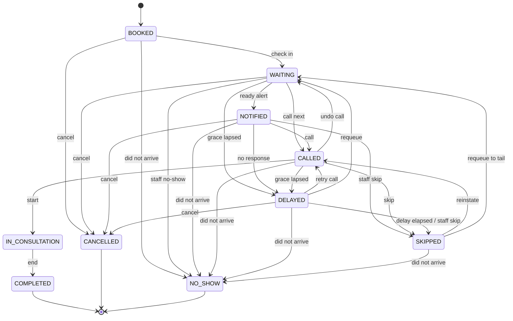

# Appointment state machine

The backend is the only authority over appointment status. The web client
requests **actions** (`cancel`, `call`, `start`, `complete`, `skip`, `arrive`,
`check-in`) and never sets a status field directly. Every action is validated
against this table before any row is written.

Source of truth: `packages/shared/src/state-machine.ts` (with
`packages/shared/test/state-machine.test.ts`). Queue actions are implemented in
`apps/api/src/modules/queue/queue.service.ts`.

## Transitions

| From | Allowed next states |
|---|---|
| `BOOKED` | `WAITING`, `CANCELLED`, `NO_SHOW` |
| `WAITING` | `NOTIFIED`, `CALLED`, `DELAYED`, `CANCELLED`, `NO_SHOW` |
| `NOTIFIED` | `CALLED`, `DELAYED`, `SKIPPED`, `CANCELLED`, `NO_SHOW` |
| `CALLED` | `IN_CONSULTATION`, `DELAYED`, `SKIPPED`, `WAITING`, `NO_SHOW` |
| `DELAYED` | `CALLED`, `WAITING`, `SKIPPED`, `CANCELLED`, `NO_SHOW` |
| `IN_CONSULTATION` | `COMPLETED` |
| `SKIPPED` | `CALLED`, `WAITING`, `NO_SHOW` |
| `COMPLETED` | — (terminal) |
| `CANCELLED` | — (terminal) |
| `NO_SHOW` | — (terminal) |

Self-transitions are always rejected. Anything not listed returns
`INVALID_TRANSITION` (HTTP 409). `isTerminal()` treats a status with no
outgoing edges as final.

## Diagram

## Semantics

- `NOTIFIED` means "an alert was sent", not "the patient is in the room". It is
  still a waiting state and can return to the normal flow.
- `CALLED` starts the grace timer (`GRACE_MINUTES`, default 10). When it lapses,
  `expireGrace` moves the visit to **`DELAYED`** and sends a delay warning.
- A further `DELAY_MINUTES` (default 10) of no response allows `autoSkip` to
  move the visit to **`SKIPPED`** when `AUTO_SKIP_ENABLED=true`.
- `SKIPPED` is recoverable: staff can call the patient again or requeue them to
  the tail (`SKIPPED -> WAITING`). With `SKIP_POLICY=drop`, the queue row is
  deleted after the transaction but the appointment status remains `SKIPPED`.
- `NO_SHOW` is final for the appointment. The queue entry is marked `SKIPPED`
  with reason `NO_SHOW`; the transition is allowed from every non-terminal
  state except `IN_CONSULTATION`.
- `COMPLETED`, `CANCELLED`, and `NO_SHOW` are final. A completed appointment can
  never change again.
- Patients may cancel from `BOOKED`, `WAITING`, `NOTIFIED`, and `DELAYED` only
  (`CANCELLABLE_STATUSES`). Once called or in the room, cancellation is a staff
  decision.
- `QUEUE_BLOCKING_STATUSES` are `WAITING`, `NOTIFIED`, `CALLED`, `DELAYED`, and
  `IN_CONSULTATION`; these occupy a queue position for ETA calculations.
- Patient self check-in (`POST /queue/entries/:id/check-in`) is a one-time
  action per appointment. It sets `selfCheckInAt`, clears/restarts grace, maps
  `BOOKED -> WAITING` and `DELAYED -> CALLED`, and leaves other active statuses
  unchanged.

## Actions in practice

| Action | Endpoint | Result |
|---|---|---|
| Cancel (patient or staff) | `PATCH /appointments/:id/cancel` | terminal `CANCELLED`; slot and queue entry released |
| Check in (patient, own entry) | `POST /queue/entries/:id/check-in` | grace restarted; `BOOKED → WAITING`, `DELAYED → CALLED` |
| Call | `PATCH /queue/entries/:id/call` | `CALLED`, `calledAt`/`graceDeadlineAt` set, grace job enqueued |
| Start | `PATCH /queue/entries/:id/start` | `IN_CONSULTATION`, `Consultation` opened, grace/auto-skip jobs cancelled |
| Complete | `PATCH /queue/entries/:id/complete` | `COMPLETED`, duration + `endSource` recorded, ETAs recalculated |
| Skip | `PATCH /queue/entries/:id/skip` | `SKIPPED`, position released per `SKIP_POLICY` |
| Arrive / reinstate | `PATCH /queue/entries/:id/arrive` | `SKIPPED`/`WAITING` requeued to tail; otherwise calls and restarts grace |
| Reorder | `PATCH /queue/entries/:id/reorder` | positions recomputed 1..n; status unchanged |
| No-show | `PATCH /queue/entries/:id/no-show` | appointment `NO_SHOW`, queue entry `SKIPPED` with reason `NO_SHOW` |
| Swap accept | `PATCH /swaps/:id/respond` with `ACCEPT` | slots/tokens/queue positions exchanged; statuses do not change |

Every queue mutation is wrapped in a transaction that writes an `AuditLog`,
recomputes ETAs, and emits `queue:updated` / `appointment:updated` over
Socket.IO. See `docs/api.md` for request/response shapes and `docs/swap.md` for
swap-specific rules.
