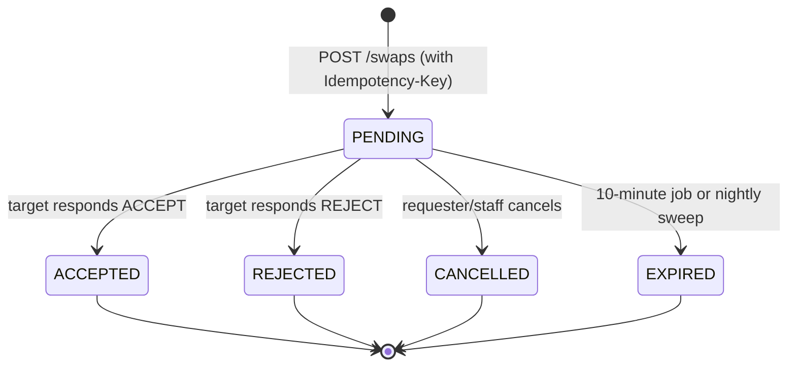

# Appointment swaps

Swaps let two patients with the **same doctor on the same hospital-local day**
exchange slots and token numbers without staff involvement. The requester
proposes; the target accepts or rejects. Staff can observe all requests and
cancel a pending one.

Endpoints (base `/api/v1`):

| Method / path | Role | Purpose |
|---|---|---|
| `POST /swaps/eligible` | `PATIENT` | Masked list of candidate appointments |
| `POST /swaps` | `PATIENT` + `Idempotency-Key` | Create a request |
| `GET /swaps?role=incoming\|outgoing\|all` | any authenticated | List own (patient) or all recent (staff) requests |
| `PATCH /swaps/:id/respond` | `PATIENT` (target only) | `ACCEPT` or `REJECT` |
| `PATCH /swaps/:id/cancel` | requester `PATIENT` or staff | Cancel a pending request |

Source: `apps/api/src/modules/swaps/swap.service.ts`, `swap.router.ts`,
`swap.schema.ts`, and the partial unique indexes in
`apps/api/prisma/migrations/20261113062500_swap_pending_unique`.

## Configuration

| Variable | Default | Meaning |
|---|---:|---|
| `SWAP_CUTOFF_MINUTES` | 60 | Both slots must start at least this far in the future |
| `SWAP_EXPIRY_MINUTES` | 10 | Unanswered requests expire via BullMQ (plus a nightly sweep) |

`SWAPPABLE` statuses are `BOOKED`, `WAITING`, and `NOTIFIED`. `DELAYED`,
`CALLED`, `IN_CONSULTATION`, `COMPLETED`, `CANCELLED`, `SKIPPED`, and `NO_SHOW`
are not eligible.

## Rule table

"Emitted code" is what the client actually receives. Several specific codes in
the shared catalogue are declared but the current service raises the generic
`CONFLICT` instead; those are called out explicitly.

| Test ID | Rule | Enforcement | Emitted result | Coverage |
|---|---|---|---|---|
| `SW-01` | Create, eligibility lookup, and response are patient-only; staff/admin get `403` | `authorize("PATIENT")` + service role guard | `403 FORBIDDEN` | `docs/rbac.md` matrix / `apps/api/test/rbac-matrix.test.ts` (DB-free) |
| `SW-02` | Requester must own `requesterAppointmentId` | `createSwapRequest()` patient lookup | `403 FORBIDDEN` | API integration / manual demo |
| `SW-03` | Both appointment IDs must exist | `findUnique` before validation | `404 NOT_FOUND` | API integration / manual demo |
| `SW-04` | Both appointments share `doctorId` and `serviceDay` | `createSwapRequest()` | `409 CONFLICT` (`SWAP_NOT_ELIGIBLE` is declared but unused) | API integration / manual demo |
| `SW-05` | Both statuses are `BOOKED`, `WAITING`, or `NOTIFIED` | `SWAPPABLE` check at create and again at accept | `409 CONFLICT` | API integration / manual demo |
| `SW-06` | Earlier slot starts at least `SWAP_CUTOFF_MINUTES` from now | `createSwapRequest()` | `409 CONFLICT` | API integration with clock control |
| `SW-07` | `POST /swaps` requires `Idempotency-Key` (1–128 safe chars) | `middleware/idempotency.ts` | `400 BAD_REQUEST`; same key + different body/token → `409 CONFLICT` | `docs/api.md` / `docs/errors.md` |
| `SW-08` | Candidates are same doctor/day, status-eligible, exclude the caller and any appointment with a pending swap; max 30 | `eligibleForSwap()` | `200` with `appointmentId`, `tokenNumber`, `slotStart`, `patientInitials` only | API integration / manual demo |
| `SW-09` | At most one `PENDING` request per appointment in either role | DB partial unique indexes + in-transaction `count` | `409 CONFLICT` (`SWAP_ALREADY_PENDING` is declared but unused) | DB-gated swap concurrency test under `apps/api/test/integration/` (DB required) |
| `SW-10` | Both appointment rows are locked in sorted-ID order before the pending check and insert | `lockAppointments()` with `SELECT ... FOR UPDATE` | Prevents two requests claiming the same slot | DB-gated swap concurrency test under `apps/api/test/integration/` (DB required) |
| `SW-11` | Only the target patient may respond | `swap.targetPatientId === patient.id` | `403 FORBIDDEN` | API integration / manual demo |
| `SW-12` | Response requires `PENDING` and not past `expiresAt` | Row lock + fresh re-read in transaction | `409 CONFLICT` (`SWAP_EXPIRED`/410 is declared but unused) | DB-gated swap concurrency test under `apps/api/test/integration/` (DB required) |
| `SW-13` | Accept re-reads both appointments after locking and rechecks eligibility | `respondSwap("ACCEPT")` transaction | `409 CONFLICT` if state changed | DB-gated swap concurrency test under `apps/api/test/integration/` (DB required) |
| `SW-14` | Accept atomically exchanges `slotStart`, `slotEnd`, `tokenNumber`, and both queue `position` values | Single Prisma transaction | `200` with accepted swap | DB-gated swap concurrency test under `apps/api/test/integration/` (DB required) |
| `SW-15` | Accept writes `AuditLog` action `SWAP_ACCEPTED` with both appointment IDs inside the same transaction | `tx.auditLog.create` | Audit row visible in `GET /admin/audit` | DB-gated swap concurrency test under `apps/api/test/integration/` (DB required) |
| `SW-16` | Reject leaves appointments and queue positions untouched | `respondSwap("REJECT")` updates only the swap row | `200 REJECTED` + requester notification | API integration / manual demo |
| `SW-17` | Cancel is allowed for the requester patient or any staff role, and only while `PENDING` | `cancelSwap()` ownership + status check | `200 CANCELLED` / `403` / `409` | API integration / manual demo |
| `SW-18` | Unanswered requests expire after 10 minutes; nightly sweep catches missed jobs | `swap-expiry:*` BullMQ job + `expirePendingSwaps()` | `EXPIRED` + notifications to both patients | Job integration / manual clock test |
| `SW-19` | Accepted and expired notifications are deduped per swap and per patient | `notify({ dedupeKey })` | `SWAP_ACCEPTED` / `SWAP_EXPIRED` rows, in-app + web push where available | API integration / manual demo |
| `SW-20` | Self-swap is rejected (requester and target must be different appointments) | Explicit `requester.id === target.id` guard in `createSwapRequest()` (`apps/api/src/modules/swaps/swap.service.ts`) | `400 BAD_REQUEST` (`SWAP_SELF` is declared but unused) | API integration / manual demo |

> No DB-free swap test is part of this documentation task. The concurrency rows
> above are covered by the DB-gated swap concurrency test under
> `apps/api/test/integration/` (DB required). The DB-free
> `apps/api/test/rbac-matrix.test.ts` only asserts route roles.

## Lifecycle

Only `PENDING` requests block new ones. Once a swap reaches any terminal state,
both appointments are eligible for a new proposal again.

## Client sequence

1. Patient A calls `POST /swaps/eligible` with their appointment ID.
2. Patient A calls `POST /swaps` with both IDs and a fresh `Idempotency-Key`.
   Retrying after a timeout must reuse the **same key and body**.
3. Patient B receives `SWAP_REQUESTED` (in-app/Web Push) and a
   `swap:requested` socket hint, then calls `PATCH /swaps/:id/respond`.
4. On `ACCEPT`, both patients receive `SWAP_ACCEPTED`, both appointment views
   refetch, and the doctor's queue emits `queue:updated`.
5. On `REJECT`, `CANCEL`, or `EXPIRED`, no slot data changes and the requester
   receives the corresponding notification.

Masking matters: the candidate list returns only initials and token/slot data.
Full names and phone numbers are available only in each patient's own records
or to staff through the audit/admin views.
